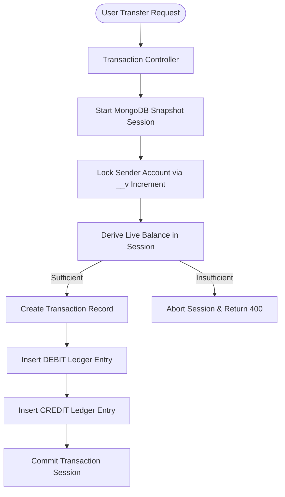

# Fluxpay - High-Integrity Financial Engine & Double-Entry Ledger

A double-entry financial accounting platform built with **Node.js/Express**, **MongoDB ACID Transactions**, **Express-Validator**, **Jest + Supertest**, and a minimalist **Black & White architectural frontend** inspired by [vahamobility.com](https://vahamobility.com/).

---

## 📑 Table of Contents
1. [Architecture & Design Principles](#-architecture--design-principles)
2. [Concurrency, Race Conditions & Overdraft Prevention](#-concurrency-race-conditions--overdraft-prevention)
3. [Ledger Reconciliation Engine](#-ledger-reconciliation-engine)
4. [Project Structure](#-project-structure)
5. [Complete API Reference](#-complete-api-reference)
6. [Input Validation Layer](#-input-validation-layer)
7. [Automated Testing Suite (Jest + Supertest)](#-automated-testing-suite-jest--supertest)
8. [Frontend Experience (Monochrome Architecture)](#-frontend-experience-monochrome-architecture)
9. [Environment Variables](#-environment-variables)
10. [Quick Start & Setup](#-quick-start--setup)
11. [Production Deployment Guide (Render & Netlify)](#-production-deployment-guide)
12. [Engineering & Interview Talking Points](#-engineering--interview-talking-points)

---

## 🏛 Architecture & Design Principles

### 1. True Double-Entry Accounting
In traditional naive banking apps, an account balance is simply a mutable integer column:
```sql
UPDATE accounts SET balance = balance - 100 WHERE id = 1; -- Dangerous
```
In **Fluxpay**, an account balance is **never stored as a mutable number**. Instead:
- Every movement of money writes two balanced records: one **DEBIT** on the sender and one **CREDIT** on the receiver.
- The balance is **dynamically derived** at query time by summing credits and subtracting debits:
  $$\text{Balance} = \sum \text{Credits} - \sum \text{Debits}$$
- Schema-level Mongoose pre-hooks strictly block `updateOne`, `updateMany`, `deleteOne`, and `deleteMany` operations on the ledger collection, guaranteeing **immutability**.



### 2. Idempotency Protection
Network timeouts, double-clicks, and client retries often cause accidental duplicate payments. Fluxpay enforces a required `idempotencyKey` (UUID) per transfer:
- A unique index on `idempotencyKey` guarantees that an identical request sent multiple times is processed **exactly once**.
- Duplicate requests are caught and safely returned as HTTP `409 Conflict`.

---

## 🛡 Concurrency, Race Conditions & Overdraft Prevention

### The Concurrency Vulnerability (Read-Check-Write Race)
When two simultaneous withdrawal requests arrive at the exact same millisecond:
1. **Thread 1** reads Sender Balance: ₹1,000.
2. **Thread 2** reads Sender Balance: ₹1,000.
3. Both threads check $₹1,000 \ge ₹900$ $\rightarrow$ both pass.
4. Thread 1 commits a ₹900 withdrawal (Account balance is now ₹100).
5. Thread 2 commits a ₹900 withdrawal (Account balance drops to **-₹800** $\rightarrow$ **Critical Overdraft!**).

### How Fluxpay Guarantees 0 Overdrafts

Fluxpay prevents this through a multi-tier defense:

1. **MongoDB Snapshot Session Isolation**:
   Every transfer executes inside an explicit transaction session:
   ```javascript
   session.startTransaction({
     readConcern: { level: "snapshot" },
     writeConcern: { w: "majority" },
   });
   ```

2. **Atomic Document Write-Lock (`__v` Version Increment)**:
   Before reading the balance or creating ledger rows, the engine performs an atomic update on the sender's account inside the session:
   ```javascript
   const fromUserAccount = await accountModel.findOneAndUpdate(
     { _id: fromAccount, status: "ACTIVE" },
     { $inc: { __v: 1 } },
     { session, returnDocument: 'after' }
   );
   ```
   - In MongoDB WiredTiger, an update places an **exclusive write lock** on the document for the duration of the transaction.
   - Any concurrent request attempting to access or withdraw from this account must wait or will immediately encounter a `WriteConflict` / `TransientTransactionError`.

3. **Session-Scoped Balance Derivation**:
   Balance is derived **inside** the snapshot session via:
   ```javascript
   const balance = await fromUserAccount.getBalance(session);
   ```
   If the balance is insufficient, `session.abortTransaction()` is called, immediately releasing all resources.

4. **Transient Error Handling**:
   Write conflict errors from concurrent requests are trapped cleanly and returned as HTTP `409 Conflict`, instructing clients to retry safely without corrupted state.

---

## ⚖ Ledger Reconciliation Engine

Fluxpay provides a mathematical integrity audit endpoint (`GET /api/transaction/reconciliation`) that verifies the double-entry accounting guarantee across the entire database:

```http
GET /api/transaction/reconciliation
Authorization: Bearer <JWT>
```

### Audit Response Example:
```json
{
  "status": "Success",
  "audit": {
    "totalDebits": 45000,
    "totalCredits": 95000,
    "totalMintedFunds": 50000,
    "expectedCredit": 95000,
    "discrepancy": 0,
    "reconciled": true,
    "totalAccounts": 14,
    "negativeAccountsDetected": 0,
    "verifiedAt": "2026-10-27T17:50:34.000Z"
  }
}
```

### Mathematical Guarantees:
1. **Double-Entry Balance Equation**:
   $$\text{Total Credits} = \text{Total Debits} + \text{Total Initial Minted Funds}$$
   $$\text{Discrepancy} = \text{Total Credits} - (\text{Total Debits} + \text{Total Minted Funds}) = 0$$
2. **Account Non-Negativity Invariant**:
   The engine iterates through every active account in the system, calculates each balance in real time, and asserts:
   $$\text{negativeAccountsDetected} = 0$$

---

## 📁 Project Structure

```
Advance-Backend/
├── Backend/                            # Node.js + Express API server
│   ├── src/
│   │   ├── config/                     # MongoDB connection with retry logic
│   │   ├── controllers/
│   │   │   ├── auth.controller.js      # User registration, JWT login, profile
│   │   │   ├── account.controller.js   # Account creation & balance queries
│   │   │   └── transcation.controller.js# Transfers, Minting, Deposits, Reconciliation
│   │   ├── middlewares/
│   │   │   ├── auth.middleware.js      # JWT & System User verification
│   │   │   └── validator.middleware.js # Express-validator request sanitization
│   │   ├── models/
│   │   │   ├── user.model.js           # Users with bcrypt password hashing
│   │   │   ├── account.model.js        # Accounts with session-scoped balance derivation
│   │   │   ├── ledger.model.js         # Immutable DEBIT/CREDIT ledger entries
│   │   │   ├── transaction.model.js    # Transfer records with unique idempotencyKey
│   │   │   └── blacklist.model.js      # Token invalidation list
│   │   ├── routes/                     # Express router definitions
│   │   └── services/                   # Email notification service (Nodemailer)
│   ├── tests/                          # Automated Jest + Supertest suites
│   │   ├── transfer.concurrency.test.js# Concurrency (50 transfers), idempotency & reconciliation
│   │   ├── integration.test.js         # User registration, account creation, balance checks
│   │   ├── validator.test.js           # Request validation schema tests
│   │   └── models.test.js              # Model hooks & ledger immutability tests
│   ├── scripts/                        # Admin scripts (e.g., make-system-user.js)
│   ├── server.js                       # HTTP server entry point
│   ├── package.json
│   └── .env                            # Backend configuration
│
├── frontend/                           # React + Vite application
│   ├── src/
│   │   ├── components/                 # Monochromatic UI components
│   │   │   ├── Navbar.jsx              # Navigation with user identity & logout
│   │   │   ├── AccountCard.jsx         # Balance display with copyable ID & action buttons
│   │   │   ├── TransferModal.jsx       # P2P Transfer modal with auto-idempotency
│   │   │   ├── DepositModal.jsx        # "Add Money" direct deposit modal
│   │   │   ├── SystemMintModal.jsx     # System authority liquidity mint portal
│   │   │   ├── ReconciliationModal.jsx # Real-time double-entry audit inspector
│   │   │   └── TransactionTable.jsx    # Filterable ledger transaction stream
│   │   ├── services/                   # Axios client & token manager
│   │   ├── App.jsx                     # Dashboard orchestrator & global state
│   │   ├── index.css                   # Custom Vanilla CSS Black & White design tokens
│   │   └── main.jsx
│   ├── vite.config.js                  # Vite server & /api proxy
│   └── package.json
│
└── package.json                        # Monorepo runner scripts
```

---

## 📡 Complete API Reference

### Authentication (`/api/auth`)
| Method | Endpoint | Description | Auth Required |
| :--- | :--- | :--- | :---: |
| `POST` | `/api/auth/register` | Register new user account (`name`, `email`, `password`) | No |
| `POST` | `/api/auth/login` | Login user, receives JWT in response & HTTP-only cookie | No |
| `GET` | `/api/auth/me` | Fetch authenticated user profile & system authority status | Yes |
| `POST` | `/api/auth/logout` | Invalidate token and blacklist session | Yes |

### Accounts (`/api/account`)
| Method | Endpoint | Description | Auth Required |
| :--- | :--- | :--- | :---: |
| `POST` | `/api/account` | Create new financial account for user | Yes |
| `GET` | `/api/account` | List all accounts belonging to the user with live balances | Yes |
| `GET` | `/api/account/balance/:accountId` | Query real-time derived balance of an account | Yes |

### Transactions & Ledger (`/api/transaction`)
| Method | Endpoint | Description | Auth Required |
| :--- | :--- | :--- | :---: |
| `POST` | `/api/transaction` | Execute P2P transfer with idempotency key | Yes |
| `POST` | `/api/transaction/deposit` | Direct deposit / "Add Money" to an account | Yes |
| `POST` | `/api/transaction/mint` | Mint initial liquidity (System Authority only) | Yes (System) |
| `GET` | `/api/transaction/history` | Query paginated/filtered transaction audit log | Yes |
| `GET` | `/api/transaction/reconciliation` | Global mathematical double-entry reconciliation audit | Yes |

---

## 🛡 Input Validation Layer

Powered by `express-validator` to ensure complete sanitization and reject malformed payloads before database operations:

- **User Registration**:
  - `name`: Must be non-empty, trimmed, min 2 characters.
  - `email`: Normalized email format (`isEmail()`).
  - `password`: Minimum 6 characters.
- **Transfers**:
  - `fromAccount` & `toAccount`: Valid 24-character MongoDB ObjectId strings.
  - `amount`: Strict positive float $> 0$.
  - `idempotencyKey`: Valid UUID or non-empty unique string (min 6 characters).
  - Validation: Prevents self-transfers (`fromAccount !== toAccount`).

---

## 🧪 Automated Testing Suite (Jest + Supertest)

A complete test suite covering input validation, model immutability, integration flows, and high-concurrency transfer stress testing.

```bash
cd Backend
npm test
```

### Test Suites Overview:

```
PASS tests/transfer.concurrency.test.js (9 tests)
  ✓ Baseline account balances setup (₹1000 and ₹0)
  ✓ Idempotency: Duplicate key returns 409 and debits sender only once
  ✓ Insufficient Balance: Transfer greater than balance returns 400
  ✓ Rollback on Failure: Non-existent recipient triggers complete session rollback
  ✓ Concurrency & Race-Conditions: 50 simultaneous transfers of ₹50 fire against ₹900 balance
    - Exactly 18 transfers succeed (18 * 50 = ₹900)
    - 32 transfers fail cleanly with 400 or 409
    - Final sender balance is exactly ₹0 (NO OVERDRAFT)
  ✓ Reconciliation Endpoint: Confirms double-entry guarantee and 0 discrepancy

PASS tests/integration.test.js (6 tests)
  ✓ Rejects registration on bad input
  ✓ Registers user and returns JWT token
  ✓ Rejects login with invalid credentials
  ✓ Retrieves profile from /api/auth/me
  ✓ Creates new financial account
  ✓ Queries account balance accurately

PASS tests/validator.test.js (9 tests)
  ✓ Validates registration payload constraints
  ✓ Validates login payload constraints
  ✓ Validates transfer payload constraints (accounts, positive amount, idempotencyKey)
  ✓ Validates mint initial funds constraints

PASS tests/models.test.js (5 tests)
  ✓ Hashes password on user save
  ✓ Correctly compares password with bcrypt
  ✓ Sets default account status to ACTIVE
  ✓ Enforces ledger immutability (blocks updateOne and deleteMany)

Test Suites: 4 passed, 4 total
Tests:       29 passed, 29 total
Snapshots:   0 total
Time:        9.099 s
```

---

## 🎨 Frontend Experience (Monochrome Architecture)

The frontend is built with **React + Vite** and styled with pure **Vanilla CSS** (no Tailwind dependency), inspired by the minimalist aesthetic of [vahamobility.com](https://vahamobility.com/):

- **Color Palette**:
  - Canvas: Obsidian `#0a0a0a`
  - Cards & Modals: Charcoal `#141414`
  - Structural Borders: Slate `#262626`
  - Text & Accents: Stark White `#ffffff` with muted metallic secondary `#a3a3a3`
- **Key User Features**:
  - **"Add Money" / Direct Deposit**: Users can instantly fund accounts with pre-set chips (₹500, ₹1,000, ₹5,000, ₹10,000) or custom amounts.
  - **P2P Transfer with Auto-Generated Idempotency Keys**: Generates UUID keys automatically to prevent double-charging.
  - **System Mint Portal**: Authority users can inject systemic liquidity.
  - **Live Ledger Reconciliation Modal**: Displays real-time double-entry proof, total debits, total credits, and verifies that no accounts are overdrawn.
  - **Filterable Transaction Audit Stream**: Search and filter ledger entries in real time.

---

## ⚙️ Environment Variables

Create a `.env` file in the `Backend/` directory:

```env
PORT=3000
MONGO_URI=mongodb+srv://<username>:<password>@cluster.mongodb.net/Fluxpay?retryWrites=true&w=majority
JWT_SECRET=your_super_secret_jwt_key_here
EMAIL_USER=your_email@gmail.com
EMAIL_PASS=your_email_app_password
SYSTEM_EMAIL=admin@system.com
```

---

## 🚀 Quick Start & Setup

### 1. Install Dependencies
```bash
# Backend
cd Backend
npm install

# Frontend
cd ../frontend
npm install
```

### 2. Run Locally
From the project root:
```bash
npm run dev:backend     # Runs Backend on http://localhost:3000
npm run dev:frontend    # Runs Frontend on http://localhost:5174
```

### 3. Run Automated Tests
```bash
npm run test:backend
# or:
cd Backend && npm test
```

---

## 🌐 Production Deployment Guide

### Deploying Backend on Render
1. Push your repository to **GitHub**.
2. Log in to [Render Dashboard](https://dashboard.render.com/) and click **New +** $\rightarrow$ **Web Service**.
3. Connect your repository.
4. Configure the Web Service settings:
   - **Name**: `fluxpay-backend` (or your choice)
   - **Region**: Closest to your users (e.g., Oregon, Frankfurt, Singapore)
   - **Branch**: `main`
   - **Root Directory**: `Backend` *(Required: points to backend subfolder)*
   - **Runtime**: `Node`
   - **Build Command**: `npm install`
   - **Start Command**: `node server.js`
5. In **Environment Variables**, add:
   - `PORT`: `10000` *(Render sets this automatically, server binds to `process.env.PORT`)*
   - `MONGO_URI`: Your MongoDB Atlas connection string *(ensure Atlas Network Access allows `0.0.0.0/0`)*
   - `JWT_SECRET`: A secure random secret key
   - `EMAIL_USER`: Your Gmail address
   - `EMAIL_PASS`: Your Gmail App Password
   - `SYSTEM_EMAIL`: System authority email (e.g., `admin@system.com`)
6. Click **Deploy Web Service**.
7. Copy your live Render URL (e.g., `https://fluxpay-backend.onrender.com`). Verify by opening `https://fluxpay-backend.onrender.com/` in your browser to see `"Ledger service is running"`.

---

### Deploying Frontend on Netlify
1. Log in to [Netlify Dashboard](https://app.netlify.com/) and click **Add new site** $\rightarrow$ **Import an existing project**.
2. Choose **GitHub** and select your repository.
3. Configure the Build Settings:
   - **Base directory**: `frontend` *(Required: points to frontend subfolder)*
   - **Build command**: `npm run build`
   - **Publish directory**: `dist` *(relative to `frontend`, or `frontend/dist`)*
4. Under **Environment variables**, click **Add a variable**:
   - **Key**: `VITE_API_URL`
   - **Value**: `https://fluxpay-backend.onrender.com/api` *(Your Render URL + `/api`)*
5. Click **Deploy Fluxpay**.
6. Netlify will build the project and output a live URL (e.g., `https://fluxpay.netlify.app`).

---

## 💡 Engineering & Interview Talking Points

### 1. "Why not store balance on the account document?"
> "In financial systems, storing balance as a mutable number is an anti-pattern. If balance is stored as a column, any bug, rogue script, or partial failure creates silent corruption with no audit trail. By using an **immutable double-entry ledger**, we derive balance dynamically. The ledger is our single source of truth; you cannot edit the past, you can only append offsetting transactions."

### 2. "How do you solve race-condition overdrafts in MongoDB?"
> "MongoDB multi-document transactions support `snapshot` read isolation. However, reading a balance inside a snapshot only gives you point-in-time isolation—two transactions reading the same snapshot could both believe there is sufficient balance. We solve this by placing an **exclusive document write-lock** on the sender's account at the start of the transaction via an atomic `$inc: { __v: 1 }`. WiredTiger locks the document, serializing concurrent withdrawals. Any overlapping request that attempts to touch the sender's account either queues or raises a `WriteConflict` / `TransientTransactionError`, which we catch and return as HTTP 409 Conflict."

### 3. "How does your system guarantee idempotency?"
> "Every transfer requires a unique client-generated `idempotencyKey`. In MongoDB, we maintain a unique compound index on this key. If network packet duplication or user double-clicking sends the transfer twice, MongoDB throws error code `11000` (duplicate key), and our controller returns HTTP 409 Conflict without writing a duplicate debit."

### 4. "How do you prove that the ledger is balanced?"
> "We provide a mathematical reconciliation endpoint (`GET /api/transaction/reconciliation`). It runs an aggregation pipeline calculating total credits, total debits, and total minted funds. It proves that `Total Credits === Total Debits + Total Minted Funds` with `discrepancy === 0`, and iterates all accounts to assert zero accounts are in an overdrawn state."
